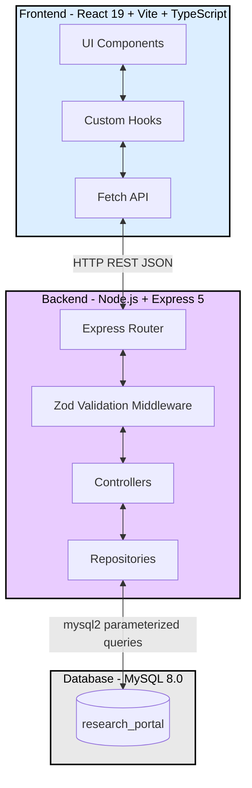

# Grading Guide — University Research Opportunity Portal

Welcome to the University Research Opportunity Portal. This guide provides an overview of the project structure, system architecture, and instructions for testing the API.

## 1. Project File Tree

This repository is strictly organized into backend, frontend, database, and API testing components.

```text
.
./backend
./backend/.env.example
./backend/node_modules
./backend/package.json
./backend/package-lock.json
./backend/src
./backend/src/app.js
./backend/src/config
./backend/src/config/db.js
./backend/src/config/env.js
./backend/src/controllers
./backend/src/controllers/opportunity.controller.js
./backend/src/middleware
./backend/src/middleware/errorHandler.js
./backend/src/middleware/notFound.js
./backend/src/middleware/validate.js
./backend/src/repositories
./backend/src/repositories/opportunity.repository.js
./backend/src/routes
./backend/src/routes/opportunity.routes.js
./backend/src/schemas
./backend/src/schemas/opportunity.schema.js
./backend/src/server.js
./bruno
./bruno/exports
./bruno/exports/research-portal.bruno.json
./bruno/Research Portal API
./bruno/Research Portal API/01-post-create-1.bru
./bruno/Research Portal API/02-post-create-2.bru
./bruno/Research Portal API/03-post-create-3.bru
./bruno/Research Portal API/04-get-all.bru
./bruno/Research Portal API/05-get-by-id1.bru
./bruno/Research Portal API/06-put-update-id1.bru
./bruno/Research Portal API/07-put-close-id1.bru
./bruno/Research Portal API/08-delete-id3.bru
./bruno/Research Portal API/09-get-id3-again.bru
./bruno/Research Portal API/10-post-missing-title-invalid-positions.bru
./bruno/Research Portal API/11-extra-get-abc-400.bru
./bruno/Research Portal API/12-extra-get-999-404.bru
./bruno/Research Portal API/13-extra-mass-assignment.bru
./bruno/Research Portal API/14-extra-whitespace-title.bru
./bruno/Research Portal API/15-extra-sql-injection.bru
./bruno/Research Portal API/16-extra-get-all-after-injection.bru
./bruno/Research Portal API/bruno.json
./bruno/Research Portal API/collection.bru
./database
./database/schema.sql
./frontend
./frontend/dist
./frontend/index.html
./frontend/node_modules
./frontend/package.json
./frontend/package-lock.json
./frontend/public
./frontend/public/favicon.svg
./frontend/public/icons.svg
./frontend/src
./frontend/src/api
./frontend/src/api/opportunities.ts
./frontend/src/App.tsx
./frontend/src/components
./frontend/src/components/atoms
./frontend/src/components/atoms/Button.tsx
./frontend/src/components/atoms/index.ts
./frontend/src/components/atoms/Input.tsx
./frontend/src/components/atoms/OutlinedButton.tsx
./frontend/src/components/atoms/PillBadge.tsx
./frontend/src/components/atoms/PrimaryButton.tsx
./frontend/src/components/atoms/SkillChip.tsx
./frontend/src/components/atoms/StatusBadge.tsx
./frontend/src/components/atoms/Sticker.tsx
./frontend/src/components/atoms/Textarea.tsx
./frontend/src/components/molecules
./frontend/src/components/molecules/FilterPills.tsx
./frontend/src/components/molecules/index.ts
./frontend/src/components/molecules/StatPills.tsx
./frontend/src/components/organisms
./frontend/src/components/organisms/DeleteConfirmModal.tsx
./frontend/src/components/organisms/EmptyState.tsx
./frontend/src/components/organisms/ErrorState.tsx
./frontend/src/components/organisms/Hero.tsx
./frontend/src/components/organisms/index.ts
./frontend/src/components/organisms/LoadingSkeleton.tsx
./frontend/src/components/organisms/MarqueeBanner.tsx
./frontend/src/components/organisms/NavBar.tsx
./frontend/src/components/organisms/OpportunityCard.tsx
./frontend/src/components/organisms/OpportunityDetailModal.tsx
./frontend/src/components/organisms/OpportunityFormModal.tsx
./frontend/src/components/organisms/OpportunityGrid.tsx
./frontend/src/components/organisms/ToastContainer.tsx
./frontend/src/hooks
./frontend/src/hooks/useOpportunities.ts
./frontend/src/hooks/useToast.ts
./frontend/src/index.css
./frontend/src/lib
./frontend/src/lib/utils.ts
./frontend/src/main.tsx
./frontend/src/styles
./frontend/src/styles/fonts.css
./frontend/src/styles/theme.css
./frontend/src/types
./frontend/src/types/opportunity.ts
./frontend/tsconfig.app.json
./frontend/tsconfig.json
./frontend/tsconfig.node.json
./frontend/vite.config.ts
./.gitignore
./README.md
```

## 2. System Architecture

The application follows a standard 3-tier architecture: React Frontend (Presentation), Node.js/Express Backend (Business Logic), and MySQL (Persistence).



**Request Flow:**
1. User interacts with the React UI.
2. Custom hooks send HTTP requests via the native `fetch` API.
3. Express Router receives the request and passes it through Zod validation.
4. The Controller handles the HTTP logic and calls the Repository.
5. The Repository executes safe, parameterized SQL queries against MySQL.
6. The response flows back in a uniform JSON envelope with the correct HTTP status code (200, 201, 400, 404, 500).

## 3. API Testing Guide

The backend API must be running (`cd backend && npm run dev`) before executing these tests. The server runs on `http://localhost:4000`.

### Option A: Bruno API Client (GUI)
1. Open the Bruno desktop application.
2. Click **Open Collection**.
3. Select the `bruno/Research Portal API` folder from this repository.
4. Click the **Run** icon to execute all 16 automated test cases (validating 200, 201, 400, 404 responses, SQL injection prevention, and mass assignment blocking).

### Option B: Bruno CLI (Terminal)
Run the following command from the project root:
```bash
cd "bruno/Research Portal API" && npx @usebruno/cli run
```
*Expected Result: 16/16 tests passed.*

### Option C: Manual cURL Commands (Terminal)
If you prefer to test the endpoints manually, use the following `curl` commands:

**1. Create Opportunity (201 Created):**
```bash
curl -i -X POST http://localhost:4000/api/opportunities \
-H "Content-Type: application/json" \
-d '{"title":"Network Security","description":"Firewall analysis","area":"Security","faculty_name":"Dr. Ahmed","department":"Computer Science","required_skills":"C++, Java","available_positions":2,"deadline":"2026-12-31"}'
```

**2. Retrieve All Opportunities (200 OK):**
```bash
curl -i http://localhost:4000/api/opportunities
```

**3. Validation Error (400 Bad Request):**
```bash
curl -i -X POST http://localhost:4000/api/opportunities \
-H "Content-Type: application/json" \
-d '{"title":"", "available_positions":-1}'
```

**4. Not Found Error (404 Not Found):**
```bash
curl -i http://localhost:4000/api/opportunities/9999
```
