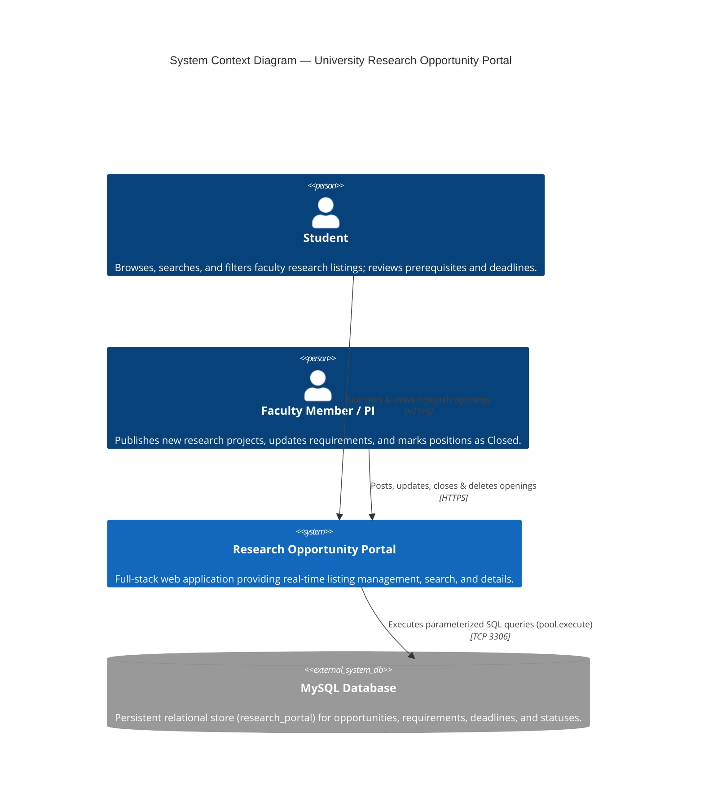
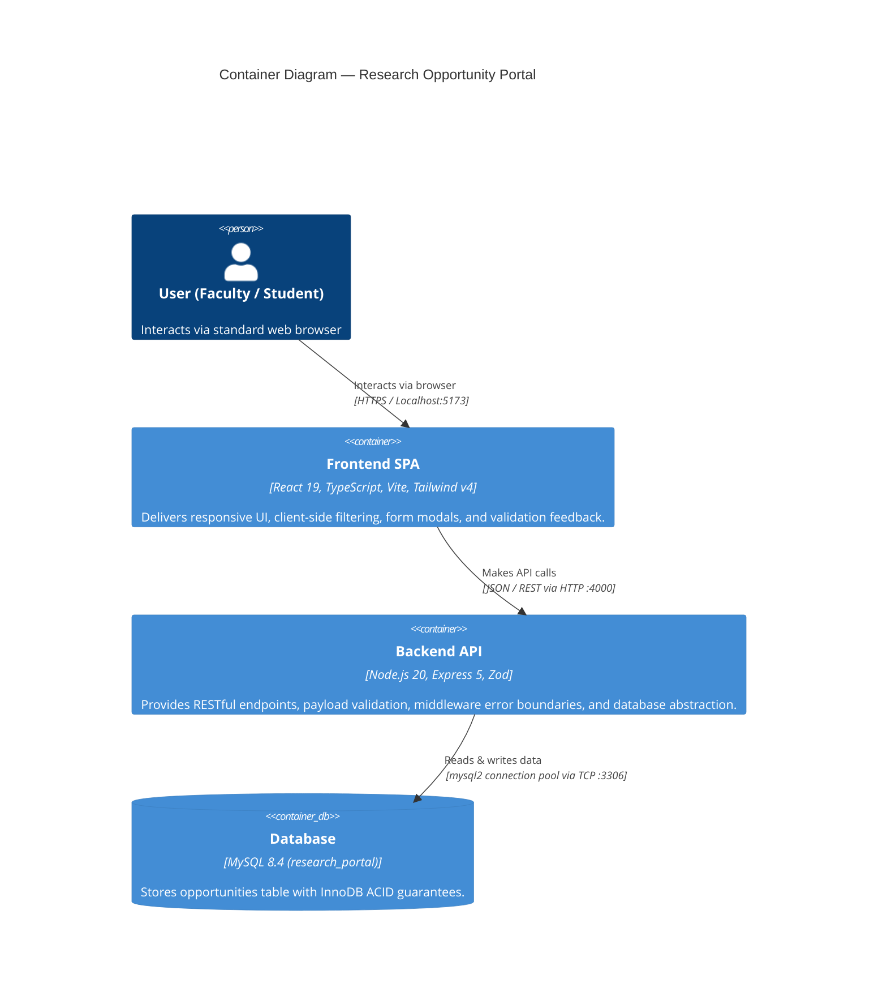
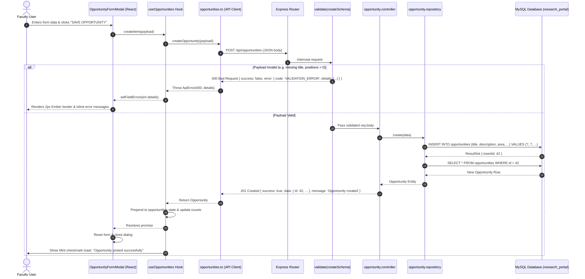
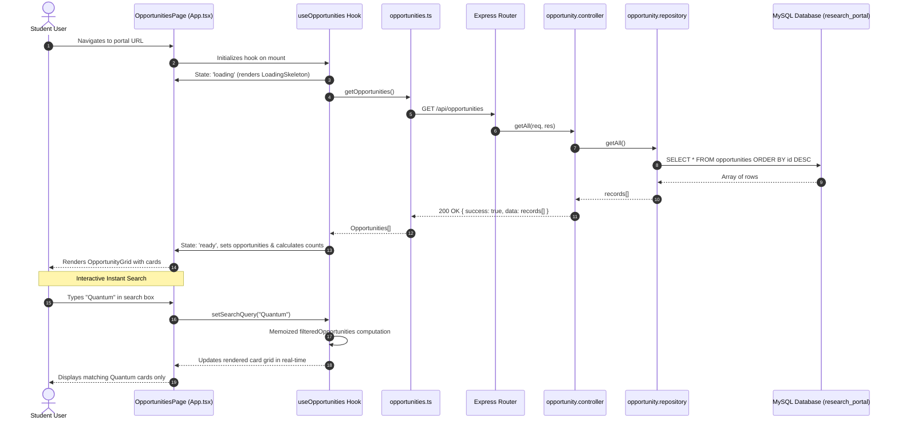
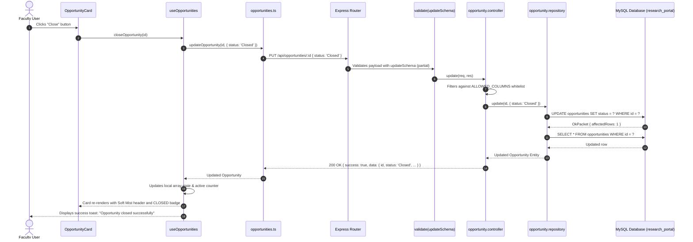
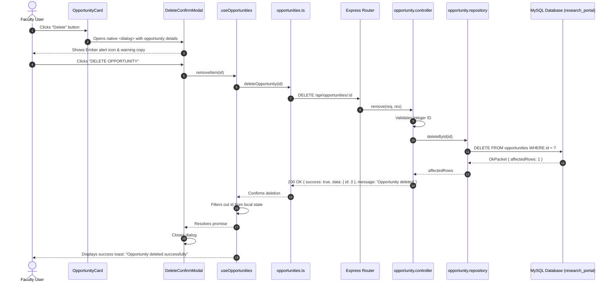
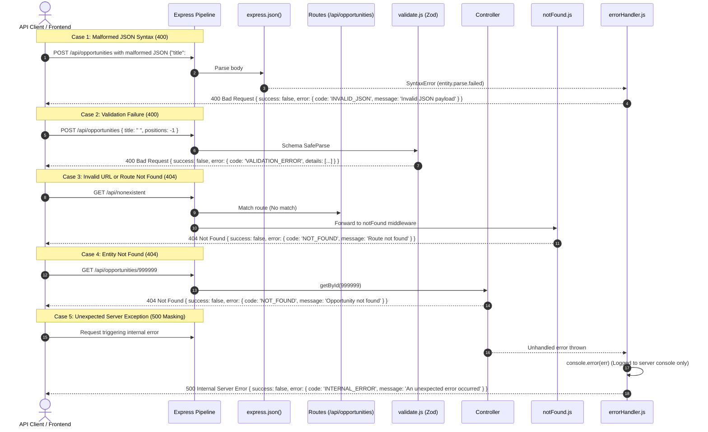

# System Architecture & Technical Flow Documentation

**Project:** University Research Opportunity Portal  
**System Version:** 1.0.0  
**Stack:** React 19 (TypeScript, Vite, Tailwind v4) · Express 5 (Node.js 20 ESM) · MySQL 8.4  
**Architectural Style:** Layered Monorepo (Controller-Repository Pattern, Atomic UI Design)

---

## 1. System Overview & Architecture Summary

The **University Research Opportunity Portal** is a full-stack, responsive web application engineered to connect faculty members seeking research assistants with students seeking academic mentorship.

The application follows a clean 3-tier architecture:
1. **Presentation Tier (Client):** Single Page Application (SPA) built with React 19, TypeScript, and Tailwind CSS v4 using the Slush flat-pastel design system.
2. **Application Tier (API):** Stateless REST API powered by Express 5 on Node.js 20 (ES Modules) enforcing strict Zod validation, parameter sanitization, global error handling middleware, and uniform JSON response envelopes.
3. **Data Tier (Persistence):** Relational storage via MySQL 8.4 utilizing InnoDB, connection pooling via `mysql2/promise`, parameterized queries (`pool.execute`), and strict column typing.

```mermaid
flowchart TD
    subgraph ClientTier ["1. Presentation Tier (Client)"]
        Browser["Web Browser (Faculty & Students)"]
        SPA["React 19 SPA (Vite + TS + Tailwind v4)\nPort: 5173"]
    end

    subgraph ApiTier ["2. Application Tier (Express API - Port: 4000)"]
        CORS["CORS Middleware\n(origin: FRONTEND_ORIGIN / localhost)"]
        BodyParser["express.json({ limit: '100kb' })"]
        ZodValidator["validate(schema)\n(createSchema / updateSchema)"]
        Router["opportunity.routes.js\n(/api/opportunities)"]
        Controller["opportunity.controller.js\n(HTTP Status & Envelope Mapping)"]
        Repository["opportunity.repository.js\n(ALLOWED_COLUMNS Whitelist)"]
        NotFoundHandler["notFound Middleware\n(404 NOT_FOUND Route Handler)"]
        ErrorHandler["errorHandler Middleware\n(Global Error Handler & 500 Masking)"]
    end

    subgraph DataTier ["3. Data Tier (Database)"]
        MySQLPool["mysql2 Connection Pool\n(dateStrings: true, limit: 10)"]
        MySQLDB[("MySQL 8.4 Database\nresearch_portal:3306\n(opportunities table)")]
    end

    Browser -->|User Actions & Events| SPA
    SPA -->|HTTP REST JSON Requests| CORS
    CORS --> BodyParser
    BodyParser -->|Malformed JSON Syntax| ErrorHandler
    BodyParser -->|Valid JSON| Router
    Router -->|Unmatched Route| NotFoundHandler
    NotFoundHandler -->|404 NOT_FOUND Envelope| SPA
    Router -->|POST / PUT| ZodValidator
    ZodValidator -->|Schema Mismatch| ErrorHandler
    ZodValidator -->|Sanitized Payload| Controller
    Router -->|GET / DELETE| Controller
    Controller -->|Domain Query/Mutation| Repository
    Repository -->|pool.execute(sql, params)| MySQLPool
    MySQLPool -->|InnoDB Query Execution| MySQLDB
    MySQLDB -.->|Result Sets / OkPacket| MySQLPool
    MySQLPool -.->|Row Arrays / affectedRows| Repository
    Repository -.->|Entity Objects| Controller
    Controller -.->|200 / 201 Success Envelope| SPA
    ErrorHandler -.->|400 / 404 / 500 Error Envelope| SPA
    SPA -.->|DOM Re-render & Toast Feedback| Browser

    classDef client fill:#dceeff,stroke:#000000,stroke-width:1.5px,color:#000000;
    classDef api fill:#e9ccff,stroke:#000000,stroke-width:1.5px,color:#000000;
    classDef err fill:#ffcfcf,stroke:#000000,stroke-width:1.5px,color:#000000;
    classDef db fill:#55db9c,stroke:#000000,stroke-width:1.5px,color:#000000;
    class Browser,SPA client;
    class CORS,BodyParser,ZodValidator,Router,Controller,Repository api;
    class NotFoundHandler,ErrorHandler err;
    class MySQLPool,MySQLDB db;
```

---

## 2. Archify Visual Model Specification

The architecture was analyzed and rendered using the **Archify** visual modeling engine (`archify 3.0.1`). The verified topology specification captures the component network, security boundaries, error handlers, and data tiers:

```json
{
  "schema_version": 1,
  "diagram_type": "architecture",
  "meta": {
    "title": "Research Opportunity Portal Architecture",
    "output": "portal-architecture.html",
    "quality_profile": "standard"
  },
  "components": [
    { "id": "client", "type": "external", "label": "Client Browser", "sublabel": "Faculty / Students", "pos": [40, 260], "size": [140, 60] },
    { "id": "react_ui", "type": "backend", "label": "React 19 App", "sublabel": "Vite + Tailwind :5173", "pos": [280, 260], "size": [150, 60] },
    { "id": "api_gateway", "type": "backend", "label": "Express 5 App", "sublabel": "CORS + JSON :4000", "pos": [520, 260], "size": [150, 60] },
    { "id": "zod_validator", "type": "security", "label": "Zod Schema", "sublabel": "POST / PUT validation", "pos": [520, 110], "size": [150, 60] },
    { "id": "not_found", "type": "middleware", "label": "notFound MW", "sublabel": "404 catch-all", "pos": [520, 410], "size": [150, 60] },
    { "id": "error_handler", "type": "middleware", "label": "errorHandler MW", "sublabel": "400/500 JSON envelope", "pos": [760, 410], "size": [160, 60] },
    { "id": "controller", "type": "backend", "label": "Controller", "sublabel": "opportunity.controller", "pos": [760, 260], "size": [150, 60] },
    { "id": "repository", "type": "backend", "label": "Repository", "sublabel": "ALLOWED_COLUMNS whitelist", "pos": [1000, 260], "size": [160, 60] },
    { "id": "db", "type": "database", "label": "MySQL 8.4", "sublabel": "research_portal:3306", "pos": [1260, 260], "size": [140, 60] }
  ],
  "boundaries": [
    { "kind": "region", "label": "Client Tier", "wraps": ["client", "react_ui"] },
    { "kind": "security-group", "label": "Node.js Express Backend", "wraps": ["api_gateway", "zod_validator", "not_found", "error_handler", "controller", "repository"] },
    { "kind": "region", "label": "Database Tier", "wraps": ["db"] }
  ],
  "connections": [
    { "id": "c1", "from": "client", "to": "react_ui", "label": "UI Events", "labelDy": -20 },
    { "id": "c2", "from": "react_ui", "to": "api_gateway", "label": "REST API", "variant": "emphasis", "labelDy": -20 },
    { "id": "c3", "from": "api_gateway", "to": "zod_validator", "label": "validate", "fromSide": "top", "toSide": "bottom", "labelDx": 35 },
    { "id": "c4", "from": "api_gateway", "to": "not_found", "label": "unmatched 404", "fromSide": "bottom", "toSide": "top" },
    { "id": "c5", "from": "api_gateway", "to": "controller", "label": "routes", "labelDy": -20 },
    { "id": "c6", "from": "controller", "to": "repository", "label": "queries", "labelDy": -20 },
    { "id": "c7", "from": "controller", "to": "error_handler", "label": "error bubble", "fromSide": "bottom", "toSide": "top" },
    { "id": "c8", "from": "repository", "to": "db", "label": "SQL pool.execute", "variant": "emphasis", "labelDy": -20 }
  ],
  "cards": [
    { "dot": "cyan", "title": "Client Tier", "items": ["React 19 Single Page App", "Tailwind CSS v4 token system", "Native HTML5 <dialog> modals"] },
    { "dot": "emerald", "title": "Backend Tier", "items": ["Express 5 without redundant service layer", "Strict Zod schemas on write endpoints", "mysql2 connection pool with parameterized SQL", "Centralized notFound and errorHandler middleware"] },
    { "dot": "rose", "title": "Database Tier", "items": ["MySQL 8.4 with UTF8MB4 charset", "Database name: research_portal", "Auto-increment unsigned primary keys", "Timestamp management for audit trail"] }
  ]
}
```

---

## 3. C4 Architectural Model

### Level 1: System Context Diagram
Shows how human actors interact with the Research Opportunity Portal within the university ecosystem.



### Level 2: Container Diagram
Decomposes the system into high-level deployable containers and execution environments.



---

## 4. End-to-End Data Flow (CRUD Lifecycle)

### A. Create Opportunity Flow (`POST /api/opportunities`)
Illustrates how a faculty member publishes a listing, passing through client validation, server-side Zod schema verification, SQL insertion, and UI toast confirmation.



### B. Read & Search Flow (`GET /api/opportunities`)
Illustrates the initial data fetch and responsive instant client-side filtering by keyword and status.



### C. Update & Close Opportunity Flow (`PUT /api/opportunities/:id`)
Illustrates partial updating and state transitions (e.g. marking an open cohort as `Closed`).



### D. Delete Flow (`DELETE /api/opportunities/:id`)
Illustrates permanent removal with native confirmation dialog and audit integrity.



### E. Error Handling & Middleware Pipeline Flow (400, 404, 500)
Illustrates how the centralized Express middleware pipeline intercepts client mistakes, missing routes, and server exceptions to return standardized JSON error envelopes without leaking sensitive data.



---

## 5. Frontend Atomic Component Hierarchy

The user interface adheres strictly to **Atomic Design** principles, ensuring modularity, clear separation of concerns, and visual consistency across all views:

```mermaid
graph TD
    subgraph Atoms ["1. Atoms (Foundational Primitives)"]
        A1["PrimaryButton\n(Carbon Pill, Min 44px)"]
        A2["OutlinedButton\n(Paper Pill, Carbon Border)"]
        A3["StatusBadge\n(Lavender Open / Soft Mist Closed)"]
        A4["PillBadge\n(Counters & Status Pills)"]
        A5["SkillChip\n(Tag Chip with 1px Border)"]
        A6["Input\n(16px Radius, Voltage Violet Focus)"]
        A7["Textarea\n(16px Radius, Ember Error State)"]
        A8["Sticker\n(14 SVG Icons, Tilt & Badges)"]
    end

    subgraph Molecules ["2. Molecules (Compound Controls)"]
        M1["FilterPills\n(ALL / OPEN / CLOSED Segmented)"]
        M2["StatPills\n(Total & Active Counter Pills)"]
    end

    subgraph Organisms ["3. Organisms (Self-Contained Functional Blocks)"]
        O1["NavBar\n(Logo, Stat Badges, + Post CTA)"]
        O2["Hero\n(Bowlby One 'RESEARCH', Sticker Cluster)"]
        O3["MarqueeBanner\n(Full-bleed Scrolling Black Ticker)"]
        O4["OpportunityCard\n(<article>, Pastel Header, Metadata, Actions)"]
        O5["OpportunityGrid\n(1/2/3 Col Responsive Layout)"]
        O6["OpportunityDetailModal\n(Native <dialog>, 32px Radius)"]
        O7["OpportunityFormModal\n(Create / Edit Modes, Zod Field Error Mapping)"]
        O8["DeleteConfirmModal\n(Native <dialog>, Ember Warning)"]
        O9["LoadingSkeleton\n(6 Soft Mist Pulsing Cards)"]
        O10["EmptyState\n(Sticker Cluster, First Post CTA)"]
        O11["ErrorState\n(Ember Badge, Retry CTA)"]
        O12["ToastContainer\n(Top-Center Fixed Stack, Mint/Ember)"]
    end

    subgraph TemplatePage ["4. Template & Page Assembly"]
        App["App.tsx (Main Assembly)\nState Management, Modal Orchestration & Layout"]
    end

    A1 --> M1
    A2 --> M1
    A4 --> M2
    A1 --> O1
    A4 --> O1
    A8 --> O2
    A3 --> O4
    A5 --> O4
    A8 --> O4
    O4 --> O5
    A1 --> O6
    A2 --> O6
    A3 --> O6
    A5 --> O6
    A8 --> O6
    A1 --> O7
    A2 --> O7
    A6 --> O7
    A7 --> O7
    A8 --> O7
    A1 --> O8
    A2 --> O8
    A8 --> O8
    A1 --> O10
    A8 --> O10
    A2 --> O11
    A8 --> O11
    A8 --> O12

    O3 --> App
    O1 --> App
    O2 --> App
    M1 --> App
    O5 --> App
    O6 --> App
    O7 --> App
    O8 --> App
    O9 --> App
    O10 --> App
    O11 --> App
    O12 --> App

    classDef atom fill:#ffffff,stroke:#000000,stroke-width:1.2px,color:#000000;
    classDef molecule fill:#dceeff,stroke:#000000,stroke-width:1.5px,color:#000000;
    classDef organism fill:#e9ccff,stroke:#000000,stroke-width:1.5px,color:#000000;
    classDef page fill:#55db9c,stroke:#000000,stroke-width:2px,color:#000000;
    class A1,A2,A3,A4,A5,A6,A7,A8 atom;
    class M1,M2 molecule;
    class O1,O2,O3,O4,O5,O6,O7,O8,O9,O10,O11,O12 organism;
    class App page;
```



---

## 6. Architectural Decision Records (ADRs)

### ADR-01: Direct Controller-Repository Pattern (Bypassing Service Layer)
* **Context:** The application is a focused, high-performance CRUD domain for research listings without complex multi-system transaction workflows.
* **Decision:** Connect Express Controllers directly to the `opportunityRepository`.
* **Rationale:** Eliminates boilerplate pass-through classes, improves code readability, and satisfies the principle of least complexity (YAGNI). Express 5 handles async promise rejections natively without try/catch wrapper bloat.

### ADR-02: Native `<dialog>` Modals vs. External UI Libraries
* **Context:** Modals require accessible focus trapping, keyboard navigation (`Escape`), backdrop clicking, and screen reader announcements.
* **Decision:** Utilize the standard HTML5 `<dialog>` element via React `useRef` and `showModal()` / `close()` APIs.
* **Rationale:** Avoids heavyweight dependencies (such as Radix UI or headless UI bundles), prevents runtime overhead, eliminates bundle bloat, and provides browser-native accessibility and top-layer rendering.

### ADR-03: Strict Zod Validation & Uniform JSON Response Envelope
* **Context:** The client requires predictable responses for both successful mutations and fine-grained validation failures.
* **Decision:** Every backend route returns an envelope:
  * Success: `{ success: true, data: T, message?: string }`
  * Failure: `{ success: false, error: { code: string, message: string, details?: Array<{ field?: string, message: string }> } }`
* **Rationale:** Allows the frontend `useOpportunities` hook and `OpportunityFormModal` to directly map backend validation errors to form fields, setting `aria-invalid="true"`, dynamic `aria-describedby` links, and 2px Ember borders.

### ADR-04: Parameterized SQL with Single-Source `ALLOWED_COLUMNS` Whitelist
* **Context:** Partial updates (`PUT /api/opportunities/:id`) accept arbitrary subset fields. Direct query construction risks SQL injection or column tampering.
* **Decision:** `ALLOWED_COLUMNS` is defined and exported as a single source of truth in `backend/src/repositories/opportunity.repository.js`. Both the controller (`opportunity.controller.js`) and repository (`opportunity.repository.js`) consume this array:
  1. The controller filters incoming request body keys to ensure only valid columns are passed down.
  2. The repository iterates over the whitelist to construct parameterized `${updates.join(', ')}` clauses and executes via `pool.execute(sql, params)`.
* **Rationale:** Completely prevents SQL injection and mass-assignment vulnerabilities while maintaining clean, DRY architecture.
