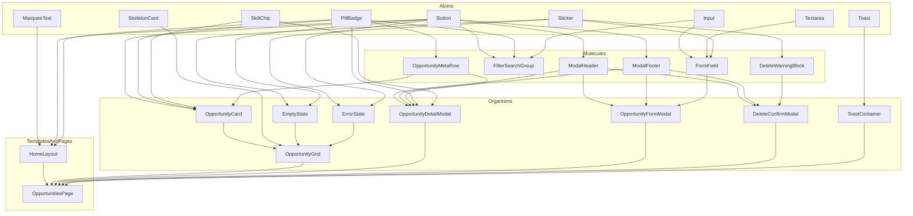

# Atomic Design Component Map & Architecture Specification

**Project:** Research Opportunity Portal  
**Document ID:** `docs/design/p4-s4-c-atomic-map.md`  
**Phase:** P4-S4-C (TypeScript Contracts & Atomic Component Map)  
**Author:** Frontend Architect Agent  
**Design Reference:** Google Stitch Screens S1–S9 & Slush Design Tokens (`DESIGN.md`, `UI_DESIGN_SPEC.md`)  
**Backend Alignment:** `backend/src/schemas/opportunity.schema.js` & `database/schema.sql` (field: `area`)

---

## 1. Architectural Principles & System Constraints

This architecture follows strict **Atomic Design** hierarchy and modern **React 19** composition patterns. Every component maps directly to Google Stitch screens S1–S9 and enforces the following hard constraints:

1. **Zero Gradients & Zero Drop Shadows:** All elevation is achieved purely through flat color contrast, 1px solid Carbon (`#000000`) outlines, and a flat 50% Carbon scrim (`rgba(0, 0, 0, 0.5)`).
2. **Fixed 11-Color Slush Palette:**
   - `Carbon` (`#000000`): Outlines, primary text, primary button fill, marquee background.
   - `Paper White` (`#ffffff`): Page canvas, card bodies, modal bodies, input backgrounds.
   - `Sky Wash` (`#dceeff`): Hero section pastel ground, page backdrop wash.
   - `Concrete Gray` (`#cccccc`): Neutral footer band and section interlude.
   - `Soft Mist` (`#e9e9e9`): Disabled controls, "Closed" status badge, skeleton cards.
   - `Electric Blue` (`#4da2ff`): Rotating card header wash 3, hero sticker accent (never button CTA fill).
   - `Mint Pop` (`#55db9c`): Rotating card header wash 2, success checkmark sticker.
   - `Lavender` (`#e9ccff`): Rotating card header wash 1, "Open" status badge, modal header band.
   - `Ember` (`#fb4903`): Error stickers, delete buttons, required dot stickers, validation borders.
   - `Sunburst` (`#ffd731`): Decorative sticker accents (lightbulb, stars; never text backgrounds).
   - `Voltage Violet` (`#5c4ade`): Focus rings (`2px solid + 2px offset`), active filter chip text fill.
3. **Geometry & Radii:**
   - Pills (buttons, badges, chips, nav): `1600px` (`rounded-full`).
   - Cards & error panels: `20px` (`rounded-[20px]`).
   - Modals & dialogs: `32px` (`rounded-[32px]`).
   - Form inputs & textareas: `16px` (`rounded-[16px]`).
4. **Data Contract Fidelity:**
   - Field name is strictly `area` (VARCHAR(100)), **not** `research_area`.
   - Strict typing across all component props. No `any` types permitted.
   - Presentational vs. Container separation: Presentational components receive pure props and emit typed events; Container (`OpportunitiesPage`) orchestrates data fetching and state transitions.

---

## 2. Stitch Screen Coverage Matrix (S1–S9)

| Screen ID | Screen Name | Atomic Components Involved | Key Visual & Interactive Behaviors |
|---|---|---|---|
| **S1** | Home (Desktop/Mobile) | `HomeLayout`, `MarqueeText`, `FilterSearchGroup`, `OpportunityGrid`, `OpportunityCard`, `Button`, `PillBadge`, `SkillChip` | Full-width marquee, Sky Wash hero with "RESEARCH" wordmark & stat pills, 3-column responsive card grid, filter pills, card actions (View, Edit, Close, Delete). |
| **S2** | Loading Skeleton | `HomeLayout`, `OpportunityGrid`, `SkeletonCard`, `MarqueeText` | 6 soft mist skeleton cards with 1px black outline, pulsing opacity animation, respects `prefers-reduced-motion`. |
| **S3** | Empty State | `HomeLayout`, `OpportunityGrid`, `EmptyState`, `Sticker`, `Button` | Playful tilted SVG sticker cluster (atom, flask, bulb, cap), "No opportunities yet" heading, "+ Post the first one" primary CTA. |
| **S4** | Error State | `HomeLayout`, `OpportunityGrid`, `ErrorState`, `Sticker`, `Button` | 20px card with Ember "!" sticker, "Couldn't reach the server", port 4000 reminder, outlined "Retry" pill button. |
| **S5** | Opportunity Detail Modal | `OpportunityDetailModal`, `ModalHeader`, `ModalFooter`, `OpportunityMetaRow`, `PillBadge`, `SkillChip`, `Button` | 32px card modal over 50% Carbon scrim, Lavender header, full details, faculty PI, department, positions, deadline, Edit/Close CTAs. |
| **S6** | Post Opportunity Modal (Create) | `OpportunityFormModal`, `ModalHeader`, `ModalFooter`, `FormField`, `Input`, `Textarea`, `Sticker`, `Button` | 8-field form, required Ember dot markers, comma-separated skill helper, number stepper, date picker, Cancel & Save buttons. |
| **S7** | Validation State Modal | `OpportunityFormModal`, `FormField`, `Input`, `Sticker`, `Toast` | 2px Ember input borders, inline error messages with Ember "!" stickers, top-center notification toast banner. |
| **S8** | Delete Confirmation Modal | `DeleteConfirmModal`, `ModalHeader`, `ModalFooter`, `DeleteWarningBlock`, `Sticker`, `Button` | Compact 440px dialog, circular Ember warning sticker, bold opportunity title, permanent deletion copy, Cancel (default focus) + Delete action. |
| **S9** | Notification Toast States | `ToastContainer`, `Toast`, `Sticker`, `Button` | Fixed top-center white pill toasts, Mint checkmark (success: "Opportunity saved"), Ember "!" (error: "Could not reach the server"), dismiss/retry actions. |

---

## 3. Atomic Design Hierarchy



---

## 4. Component Specifications

### 4.1 Atoms

#### 1. `Button`
- **Location:** `frontend/src/components/atoms/Button.tsx`
- **Purpose:** Primary interactive element across all screens. Provides pill and circular variants.
- **Design Tokens:** 1px black outline, 1600px radius (or circular 40px), min-height 40px (WCAG touch target).
- **Variants:**
  - `primary`: Carbon `#000000` fill, Paper White `#ffffff` text, hover: `#1a1a1a`.
  - `secondary`: Paper White `#ffffff` fill, Carbon text, hover: Soft Mist `#e9e9e9`.
  - `danger`: Carbon `#000000` fill with Ember accent border/hover, or Ember outline.
  - `icon`: 40px x 40px circle, 1px black outline, centered icon.
  - `ghost`: Transparent fill, Carbon text, hover: Soft Mist.
- **TypeScript Interface:**
```typescript
import { ButtonHTMLAttributes, ReactNode } from 'react';

export type ButtonVariant = 'primary' | 'secondary' | 'danger' | 'icon' | 'ghost';
export type ButtonSize = 'sm' | 'md' | 'lg';

export interface ButtonProps extends ButtonHTMLAttributes<HTMLButtonElement> {
  variant?: ButtonVariant;
  size?: ButtonSize;
  isLoading?: boolean;
  loadingText?: string;
  leftIcon?: ReactNode;
  rightIcon?: ReactNode;
  children?: ReactNode;
}
```

#### 2. `PillBadge`
- **Location:** `frontend/src/components/atoms/PillBadge.tsx`
- **Purpose:** Compact visual indicator for status, counts, and stats.
- **Design Tokens:** 1600px radius, 1px black outline, Inter 700 12px uppercase, letter-spacing 0.032em.
- **Variants:**
  - `open`: Lavender `#e9ccff` fill, Carbon text, dot indicator.
  - `closed`: Soft Mist `#e9e9e9` fill, Carbon text, lock icon.
  - `stat`: Paper White `#ffffff` or Sky Wash `#dceeff` fill with outline.
  - `neutral`: Soft Mist `#e9e9e9` fill, Carbon text.
- **TypeScript Interface:**
```typescript
import { ReactNode } from 'react';
import { OpportunityStatus } from '../../types/opportunity';

export type PillBadgeVariant = 'open' | 'closed' | 'stat' | 'neutral';

export interface PillBadgeProps {
  variant: PillBadgeVariant | OpportunityStatus;
  label: string;
  icon?: ReactNode;
  className?: string;
}
```

#### 3. `SkillChip`
- **Location:** `frontend/src/components/atoms/SkillChip.tsx`
- **Purpose:** Compact tag displaying individual required skills parsed from comma-separated string.
- **Design Tokens:** 1600px radius, 1px black outline, Paper White fill (or Voltage Violet `#5c4ade` when selected), 12px/13px Inter 500.
- **TypeScript Interface:**
```typescript
export interface SkillChipProps {
  skill: string;
  selected?: boolean;
  onClick?: (skill: string) => void;
  className?: string;
}
```

#### 4. `Input`
- **Location:** `frontend/src/components/atoms/Input.tsx`
- **Purpose:** Single-line form input (text, date, number).
- **Design Tokens:** 16px radius, 1px black outline (2px Ember `#fb4903` on error), min-height 44px, focus: 2px Voltage Violet with 2px offset.
- **TypeScript Interface:**
```typescript
import { InputHTMLAttributes } from 'react';

export interface InputProps extends InputHTMLAttributes<HTMLInputElement> {
  isInvalid?: boolean;
  hasError?: boolean;
}
```

#### 5. `Textarea`
- **Location:** `frontend/src/components/atoms/Textarea.tsx`
- **Purpose:** Multi-line text field for opportunity description.
- **Design Tokens:** 16px radius, 1px black outline (2px Ember on error), min-height 120px, 5 rows default.
- **TypeScript Interface:**
```typescript
import { TextareaHTMLAttributes } from 'react';

export interface TextareaProps extends TextareaHTMLAttributes<HTMLTextAreaElement> {
  isInvalid?: boolean;
  hasError?: boolean;
}
```

#### 6. `Sticker`
- **Location:** `frontend/src/components/atoms/Sticker.tsx`
- **Purpose:** Hand-cut aesthetic SVG icons with 1px black outline.
- **Icon Types:** `atom`, `flask`, `lightbulb`, `magnifier`, `grad-cap`, `checkmark` (Mint), `exclamation` (Ember), `trash` (Ember), `close`, `plus`, `search`, `calendar`, `users`, `lock`.
- **TypeScript Interface:**
```typescript
export type StickerIconName =
  | 'atom'
  | 'flask'
  | 'lightbulb'
  | 'magnifier'
  | 'grad-cap'
  | 'checkmark'
  | 'exclamation'
  | 'trash'
  | 'close'
  | 'plus'
  | 'search'
  | 'calendar'
  | 'users'
  | 'lock';

export interface StickerProps {
  name: StickerIconName;
  size?: number | string;
  className?: string;
  'aria-hidden'?: boolean;
}
```

#### 7. `Toast`
- **Location:** `frontend/src/components/atoms/Toast.tsx`
- **Purpose:** Floating pill banner notification matching Stitch S9.
- **Design Tokens:** 20px radius, 1px black outline, Paper White fill, zero box-shadow. Success: Mint checkmark sticker. Error: Ember "!" sticker.
- **TypeScript Interface:**
```typescript
export type ToastType = 'success' | 'error' | 'info';

export interface ToastProps {
  id: string;
  type: ToastType;
  message: string;
  actionLabel?: string;
  onAction?: () => void;
  onDismiss: (id: string) => void;
  duration?: number;
}
```

#### 8. `SkeletonCard`
- **Location:** `frontend/src/components/atoms/SkeletonCard.tsx`
- **Purpose:** Loading placeholder card matching Stitch S2.
- **Design Tokens:** 20px radius, 1px black outline, Soft Mist `#e9e9e9` fill, pulsing opacity (respects `prefers-reduced-motion`).
- **TypeScript Interface:**
```typescript
export interface SkeletonCardProps {
  className?: string;
}
```

#### 9. `MarqueeText`
- **Location:** `frontend/src/components/atoms/MarqueeText.tsx`
- **Purpose:** Full-bleed scrolling ticker strip matching Stitch S1 & S2.
- **Design Tokens:** Carbon `#000000` fill, 32px height, Paper White Inter 700 12px uppercase 0.032em, continuous CSS `translateX` loop, `aria-hidden="true"`, paused under `prefers-reduced-motion`.
- **TypeScript Interface:**
```typescript
export interface MarqueeTextProps {
  items?: string[];
  speedSeconds?: number;
  className?: string;
}
```

---

### 4.2 Molecules

#### 1. `FormField`
- **Location:** `frontend/src/components/molecules/FormField.tsx`
- **Purpose:** Accessible form control wrapper binding label, input/textarea, required sticker dot, and validation error message.
- **Design Tokens:** Label: Inter 700 12px uppercase. Required marker: 6px circular Ember sticker dot. Error line: 14px Carbon text with Ember "!" sticker.
- **Accessibility:** Generates `id`, `aria-describedby`, and propagates `aria-invalid`.
- **TypeScript Interface:**
```typescript
import { ReactNode } from 'react';

export interface FormFieldProps {
  id: string;
  label: string;
  required?: boolean;
  error?: string;
  helperText?: string;
  children: ReactNode;
}
```

#### 2. `FilterSearchGroup`
- **Location:** `frontend/src/components/molecules/FilterSearchGroup.tsx`
- **Purpose:** Horizontal toolbar matching S1 with status filter pills (`ALL`, `OPEN`, `CLOSED`) and live text search input.
- **Design Tokens:** Segmented pill button container, active pill uses Carbon fill or Voltage Violet border, count badges.
- **TypeScript Interface:**
```typescript
import { OpportunityFilter } from '../../types/opportunity';

export interface FilterCounts {
  all: number;
  open: number;
  closed: number;
}

export interface FilterSearchGroupProps {
  activeFilter: OpportunityFilter;
  counts: FilterCounts;
  searchQuery: string;
  onFilterChange: (filter: OpportunityFilter) => void;
  onSearchChange: (query: string) => void;
}
```

#### 3. `OpportunityMetaRow`
- **Location:** `frontend/src/components/molecules/OpportunityMetaRow.tsx`
- **Purpose:** Formatted metadata line displaying faculty PI, department, positions count, and application deadline with sticker icons.
- **Design Tokens:** Inter 500 14px, uppercase metadata labels, icon accents.
- **TypeScript Interface:**
```typescript
export interface OpportunityMetaRowProps {
  faculty_name: string;
  department: string;
  available_positions: number;
  deadline: string;
  compact?: boolean;
}
```

#### 4. `ModalHeader`
- **Location:** `frontend/src/components/molecules/ModalHeader.tsx`
- **Purpose:** Top banner for modal dialogs matching S5, S6, S7, S8.
- **Design Tokens:** Lavender `#e9ccff` fill (or Soft Mist for neutral), 1px solid black bottom border, 32px top rounded corners, bold title, outlined circular or pill `Close` button.
- **TypeScript Interface:**
```typescript
export interface ModalHeaderProps {
  title: string;
  subtitle?: string;
  headerColor?: 'lavender' | 'soft-mist' | 'sky-wash';
  onClose: () => void;
}
```

#### 5. `ModalFooter`
- **Location:** `frontend/src/components/molecules/ModalFooter.tsx`
- **Purpose:** Action button strip at the base of modal dialogs.
- **Design Tokens:** 1px black top border, Paper White background, right-aligned (or full-width on mobile) pill buttons.
- **TypeScript Interface:**
```typescript
import { ReactNode } from 'react';

export interface ModalActionConfig {
  label: string;
  onClick: () => void;
  isLoading?: boolean;
  disabled?: boolean;
  variant?: 'primary' | 'secondary' | 'danger';
}

export interface ModalFooterProps {
  primaryAction: ModalActionConfig;
  secondaryAction?: ModalActionConfig;
  extraContent?: ReactNode;
}
```

#### 6. `DeleteWarningBlock`
- **Location:** `frontend/src/components/molecules/DeleteWarningBlock.tsx`
- **Purpose:** Destructive confirmation warning block inside `DeleteConfirmModal` matching Stitch S8.
- **Design Tokens:** Centered circular Ember sticker badge, bold heading "Delete this opportunity?", opportunity title in bold quotes, warning copy: "This action cannot be undone and will permanently remove the listing from the portal."
- **TypeScript Interface:**
```typescript
export interface DeleteWarningBlockProps {
  opportunityTitle: string;
}
```

---

### 4.3 Organisms

#### 1. `OpportunityCard`
- **Location:** `frontend/src/components/organisms/OpportunityCard.tsx`
- **Purpose:** Primary grid item displaying a single research opportunity matching Stitch S1.
- **Design Tokens:**
  - 20px radius, 1px solid black outline, Paper White body.
  - Header strip: 56px height, rotating wash based on `id % 3`:
    - `0`: Lavender (`#e9ccff`)
    - `1`: Mint Pop (`#55db9c`)
    - `2`: Electric Blue (`#4da2ff`)
  - Displays `area` (uppercase, bold) and `PillBadge` (`OPEN` / `CLOSED`).
  - Title: Subheading 24px/1.2, 2-line clamp.
  - Body: Faculty & Department, Deadline, Available Positions.
  - Required skills: Flex-wrapping row of `SkillChip` components.
  - Action footer:
    - `VIEW` (outlined pill button)
    - `EDIT` (outlined pill button)
    - `CLOSE` (outlined pill button; omitted/disabled if status is already 'Closed')
    - Circular delete button with Ember trash sticker.
- **TypeScript Interface:**
```typescript
import { Opportunity } from '../../types/opportunity';

export interface OpportunityCardProps {
  opportunity: Opportunity;
  onView: (opportunity: Opportunity) => void;
  onEdit: (opportunity: Opportunity) => void;
  onCloseOpportunity: (id: number) => void;
  onDelete: (opportunity: Opportunity) => void;
}
```

#### 2. `OpportunityGrid`
- **Location:** `frontend/src/components/organisms/OpportunityGrid.tsx`
- **Purpose:** Responsive container for opportunity listings matching S1, S2, S3, S4.
- **Design Tokens:** Responsive grid (1 col < 640px, 2 col 640–1023px, 3 col >= 1024px), 24px gap.
- **State Handling:**
  - `isLoading === true`: Renders 6 `SkeletonCard` atoms.
  - `error !== null`: Renders `ErrorState` organism with retry callback.
  - `opportunities.length === 0`: Renders `EmptyState` organism.
  - Otherwise: Renders `OpportunityCard` for each item.
- **TypeScript Interface:**
```typescript
import { Opportunity } from '../../types/opportunity';

export interface OpportunityGridProps {
  opportunities: Opportunity[];
  isLoading: boolean;
  error: string | null;
  onRetry: () => void;
  onView: (opportunity: Opportunity) => void;
  onEdit: (opportunity: Opportunity) => void;
  onCloseOpportunity: (id: number) => void;
  onDelete: (opportunity: Opportunity) => void;
  onPostClick: () => void;
  isFiltered?: boolean;
  onResetFilters?: () => void;
}
```

#### 3. `OpportunityDetailModal`
- **Location:** `frontend/src/components/organisms/OpportunityDetailModal.tsx`
- **Purpose:** Read-only modal displaying complete opportunity information matching Stitch S5.
- **Design Tokens:** Max-width 720px, 32px radius, 1px black outline, 50% Carbon scrim. Lavender `ModalHeader`. Outlined `EDIT` and `CLOSE OPPORTUNITY` pill buttons in `ModalFooter`.
- **Accessibility:** Native HTML `<dialog>` with `.showModal()`, focus trap, Esc to close, returns focus to triggering element.
- **TypeScript Interface:**
```typescript
import { Opportunity } from '../../types/opportunity';

export interface OpportunityDetailModalProps {
  opportunity: Opportunity | null;
  isOpen: boolean;
  onClose: () => void;
  onEdit: (opportunity: Opportunity) => void;
  onCloseOpportunity: (id: number) => void;
}
```

#### 4. `OpportunityFormModal`
- **Location:** `frontend/src/components/organisms/OpportunityFormModal.tsx`
- **Purpose:** Form dialog supporting both Create (S6) and Edit operations, with validation error presentation (S7).
- **Design Tokens:** Max-width 640px, 32px radius, 1px black outline, Lavender `ModalHeader`.
- **Validation Presentation:** Form fields render 2px Ember border on error with inline Ember "!" sticker and message.
- **Field List:**
  1. `title` (Input, required)
  2. `description` (Textarea, required)
  3. `area` (Input, required — strictly named `area`)
  4. `faculty_name` (Input, required)
  5. `department` (Input, required)
  6. `required_skills` (Input, required, comma-separated)
  7. `available_positions` (Input type="number", min="0", required)
  8. `deadline` (Input type="date", required)
  9. `status` (Segmented pill toggle 'Open'/'Closed'; shown in edit mode)
- **TypeScript Interface:**
```typescript
import { Opportunity, CreateOpportunityDTO, UpdateOpportunityDTO, ApiFieldError } from '../../types/opportunity';

export type FormMode = 'create' | 'edit';

export interface OpportunityFormModalProps {
  mode: FormMode;
  initialData?: Opportunity | null;
  isOpen: boolean;
  isSubmitting: boolean;
  serverErrors?: ApiFieldError[];
  onSubmit: (data: CreateOpportunityDTO | UpdateOpportunityDTO) => Promise<boolean>;
  onClose: () => void;
}
```

#### 5. `DeleteConfirmModal`
- **Location:** `frontend/src/components/organisms/DeleteConfirmModal.tsx`
- **Purpose:** Confirmation dialog before permanent deletion of a research opportunity matching Stitch S8.
- **Design Tokens:** Max-width 440px, 32px radius, 1px solid black outline, 50% flat Carbon scrim. Contains `DeleteWarningBlock`, outlined `Cancel` button (receives initial focus), and black-filled `Delete` button.
- **TypeScript Interface:**
```typescript
import { Opportunity } from '../../types/opportunity';

export interface DeleteConfirmModalProps {
  opportunity: Opportunity | null;
  isOpen: boolean;
  isDeleting: boolean;
  onConfirm: (id: number) => Promise<void>;
  onCancel: () => void;
}
```

#### 6. `EmptyState`
- **Location:** `frontend/src/components/organisms/EmptyState.tsx`
- **Purpose:** Informative zero-data canvas matching Stitch S3.
- **Design Tokens:** Centered layout, cluster of tilted hand-cut stickers (`atom`, `flask`, `lightbulb`, `magnifier`, `grad-cap`), display heading "No opportunities yet", supporting body copy, and black-filled `+ POST THE FIRST ONE` pill button.
- **TypeScript Interface:**
```typescript
export interface EmptyStateProps {
  isFiltered?: boolean;
  onPostClick: () => void;
  onResetFilters?: () => void;
}
```

#### 7. `ErrorState`
- **Location:** `frontend/src/components/organisms/ErrorState.tsx`
- **Purpose:** Graceful error presentation matching Stitch S4 when API call fails.
- **Design Tokens:** 20px radius card, circular Ember "!" sticker, bold heading "Couldn't reach the server", explanatory copy ("Check that the backend is running on port 4000."), and outlined `RETRY` pill button.
- **TypeScript Interface:**
```typescript
export interface ErrorStateProps {
  message?: string;
  onRetry: () => void;
}
```

#### 8. `ToastContainer`
- **Location:** `frontend/src/components/organisms/ToastContainer.tsx`
- **Purpose:** Fixed top-center overlay (`z-50`) managing up to 3 active floating toasts matching Stitch S9.
- **Accessibility:** `aria-live="polite"` for success notifications, `aria-live="assertive"` for errors (`role="alert"`).
- **TypeScript Interface:**
```typescript
import { ToastProps } from '../atoms/Toast';

export type ToastItem = Omit<ToastProps, 'onDismiss'>;

export interface ToastContainerProps {
  toasts: ToastItem[];
  onDismiss: (id: string) => void;
}
```

---

### 4.4 Templates and Pages

#### 1. `HomeLayout`
- **Location:** `frontend/src/components/templates/HomeLayout.tsx`
- **Purpose:** Full page structure wrapping navigation, marquee, hero band, content canvas, and footer.
- **Structure:**
  1. `MarqueeText`: Black ticker tape at very top.
  2. Top Navigation Bar: Circular 'R' logo mark, portal title "RESEARCH BOARD", active pill links, and `+ POST OPPORTUNITY` primary button.
  3. Hero Band (`Sky Wash #dceeff` background):
     - Giant display wordmark: **"RESEARCH"** (Bowlby One, line-height 0.8, ~160px).
     - Overlapping tilted sticker cluster.
     - Tagline: "Find, post and manage university research openings in one place."
     - Outlined dynamic stat pills: `{openCount} OPEN` and `{closedCount} CLOSED`.
  4. Main Content Container: `max-width: 1440px`, fluid padding 16px/24px/48px.
  5. Footer Band (`Concrete Gray #cccccc` background): 1-line metadata "Built for CN Assignment #1 — Research Opportunity Portal" and repository link.
- **TypeScript Interface:**
```typescript
import { ReactNode } from 'react';

export interface HomeLayoutProps {
  openCount: number;
  closedCount: number;
  onPostClick: () => void;
  children: ReactNode;
}
```

#### 2. `OpportunitiesPage`
- **Location:** `frontend/src/pages/OpportunitiesPage.tsx`
- **Purpose:** Container component owning application state, data orchestration, and modal dialog lifecycle.
- **State Responsibilities:**
  - Fetches opportunities list via custom hook (`useOpportunities`).
  - Computes counts: `openCount`, `closedCount`, `allCount`.
  - Maintains `searchQuery` and `activeFilter` (`'All' | 'Open' | 'Closed'`).
  - Filters opportunities using memoized predicate.
  - Controls modal visibility:
    - `detailModal`: `{ isOpen: boolean; data: Opportunity | null }`
    - `formModal`: `{ isOpen: boolean; mode: 'create' | 'edit'; data: Opportunity | null }`
    - `deleteModal`: `{ isOpen: boolean; data: Opportunity | null }`
  - Dispatches CRUD actions against API service and manages notifications via `useToast`.
- **TypeScript Interface:**
```typescript
export interface OpportunitiesPageProps {
  // Container component; self-contained with no required external props
}
```

---

## 5. State Management & Data Flow Architecture

### 5.1 Custom Hooks Specification

```
┌─────────────────────────────────────────────────────────┐
│                     OpportunitiesPage                   │
└────────────┬───────────────────────────────┬────────────┘
             │                               │
             ▼                               ▼
    ┌─────────────────┐             ┌─────────────────┐
    │useOpportunities │             │    useToast     │
    └────────┬────────┘             └────────┬────────┘
             │                               │
             ▼                               ▼
    ┌─────────────────┐             ┌─────────────────┐
    │ opportunity.api │             │ ToastContainer  │
    └─────────────────┘             └─────────────────┘
```

1. **`useOpportunities()` Hook:**
   - **File:** `frontend/src/hooks/useOpportunities.ts`
   - **Return Shape:**
```typescript
import { Opportunity, CreateOpportunityDTO, UpdateOpportunityDTO } from '../types/opportunity';

export interface UseOpportunitiesReturn {
  opportunities: Opportunity[];
  isLoading: boolean;
  error: string | null;
  refetch: () => Promise<void>;
  createOpportunity: (dto: CreateOpportunityDTO) => Promise<Opportunity>;
  updateOpportunity: (id: number, dto: UpdateOpportunityDTO) => Promise<Opportunity>;
  closeOpportunity: (id: number) => Promise<Opportunity>;
  deleteOpportunity: (id: number) => Promise<void>;
}
```

2. **`useToast()` Hook:**
   - **File:** `frontend/src/hooks/useToast.ts`
   - **Return Shape:**
```typescript
import { ToastItem } from '../components/organisms/ToastContainer';

export interface UseToastReturn {
  toasts: ToastItem[];
  showSuccess: (message: string) => void;
  showError: (message: string, onRetry?: () => void) => void;
  dismissToast: (id: string) => void;
}
```

### 5.2 API Service Contract Alignment

- **List Opportunities:** `GET /api/opportunities` → Returns `ApiEnvelope<Opportunity[]>`.
- **Get Opportunity:** `GET /api/opportunities/:id` → Returns `ApiEnvelope<Opportunity>`.
- **Create Opportunity:** `POST /api/opportunities` → Body: `CreateOpportunityDTO` → Returns `ApiEnvelope<Opportunity>`.
- **Update Opportunity:** `PUT /api/opportunities/:id` → Body: `UpdateOpportunityDTO` → Returns `ApiEnvelope<Opportunity>`.
- **Close Opportunity (Quick Action):** `PUT /api/opportunities/:id` with `{ status: 'Closed' }`.
- **Delete Opportunity:** `DELETE /api/opportunities/:id` → Returns `ApiEnvelope<{ id: number }>`.

---

## 6. Accessibility (A11y) & Usability Guarantees

1. **Keyboard Trapping & Modals:** Native `<dialog>` elements are invoked via `showModal()`, automatically preventing background scroll, trapping keyboard tab focus, and providing native `Escape` key listeners.
2. **Focus Rings:** All buttons, inputs, links, and cards show a high-contrast `2px solid #5c4ade` (Voltage Violet) outline with `2px offset` on `:focus-visible`.
3. **Contrast Compliance:** All text is Carbon (`#000000`) on light backgrounds (contrast ratio > 7:1, exceeding WCAG 2.2 AA).
4. **Motion Preferences:** The `MarqueeText` scrolling animation and `SkeletonCard` pulse animations are disabled when `window.matchMedia('(prefers-reduced-motion: reduce)')` is true.
5. **Screen Readers:**
   - Modals provide `aria-labelledby` referencing their title.
   - Decorative stickers are marked `aria-hidden="true"`.
   - Dynamic stat pills and counts use `font-feature-settings: "tnum"` for alignment.
   - Required form fields have `aria-required="true"` and visual Ember dots.

---

## 7. Component File Tree Summary

```
frontend/src/
├── types/
│   └── opportunity.ts               # Core contracts, DTOs & API envelopes
├── components/
│   ├── atoms/
│   │   ├── Button.tsx               # Primary, secondary, icon pill buttons
│   │   ├── PillBadge.tsx            # Status pills (Open, Closed, stat)
│   │   ├── SkillChip.tsx            # Comma-separated skill tag
│   │   ├── Input.tsx                # Single-line text, number, date inputs
│   │   ├── Textarea.tsx             # Multi-line description input
│   │   ├── Sticker.tsx              # Slush hand-cut SVG sticker graphics
│   │   ├── Toast.tsx                # Floating status toast
│   │   ├── SkeletonCard.tsx         # Soft Mist loading card
│   │   └── MarqueeText.tsx          # Full-bleed black scrolling strip
│   ├── molecules/
│   │   ├── FormField.tsx            # Label + required dot + input + error
│   │   ├── FilterSearchGroup.tsx    # Status filters + live search
│   │   ├── OpportunityMetaRow.tsx   # Faculty, Dept, Positions, Deadline
│   │   ├── ModalHeader.tsx          # Lavender header band + close pill
│   │   ├── ModalFooter.tsx          # Action button row
│   │   └── DeleteWarningBlock.tsx   # Ember badge + warning copy
│   ├── organisms/
│   │   ├── OpportunityCard.tsx      # Rotating header, metadata & actions
│   │   ├── OpportunityGrid.tsx      # 3-column responsive grid container
│   │   ├── OpportunityDetailModal.tsx # Read-only full detail modal
│   │   ├── OpportunityFormModal.tsx # Create & edit form modal with errors
│   │   ├── DeleteConfirmModal.tsx   # Destructive delete confirmation
│   │   ├── EmptyState.tsx           # Tilted sticker cluster + post CTA
│   │   ├── ErrorState.tsx           # Port 4000 failure card + retry
│   │   └── ToastContainer.tsx       # Top-center stack of up to 3 toasts
│   └── templates/
│       └── HomeLayout.tsx           # Marquee + Nav + Hero + Content + Footer
├── hooks/
│   ├── useOpportunities.ts          # CRUD state orchestration
│   └── useToast.ts                  # Notification queue management
└── pages/
    └── OpportunitiesPage.tsx        # Top-level Page / Container
```
